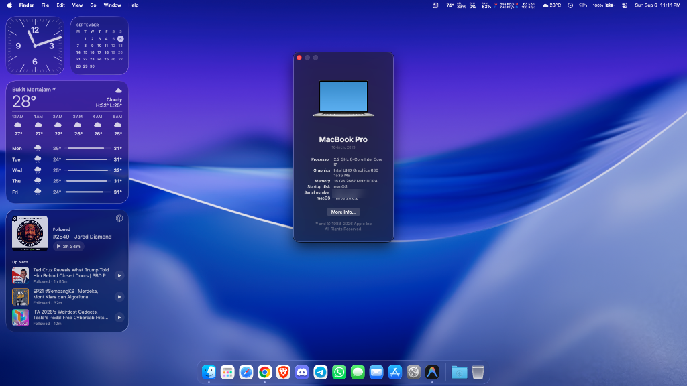

# ASUS ROG Strix GL503GE Hackintosh

[](https://github.com/acidanthera/OpenCorePkg)
[](https://www.apple.com/macos/)
[](https://rog.asus.com/)
[](https://github.com/blackosx/OpenCanopy-Icons)
[](LICENSE)

An optimized, production-ready OpenCore EFI configuration for running macOS (**Sonoma 14.x**, **Sequoia 15.x**, and **Tahoe 26.x**) on the **ASUS ROG Strix GL503GE** gaming laptop.

Built following the [Dortania OpenCore Install Guide](https://dortania.github.io/OpenCore-Install-Guide/), assisted by [OpenCore Simplify](https://github.com/lzhoang2801/OC-Simplify), and powered by [Acidanthera](https://github.com/acidanthera) kexts and drivers.

<p align="center">
  
  <br/>
  <i>macOS Tahoe running on ASUS ROG Strix GL503GE (Intel Core i7-8750H, Intel UHD Graphics 630, 16 GB DDR4)</i>
</p>

> [!WARNING]
> ### ⚠️ Legal Disclaimer & Terms of Use
> * **EULA Compliance:** Running macOS on non-Apple-branded hardware breaches Section 2B of Apple Inc.'s [macOS Software License Agreement (EULA)](https://www.apple.com/legal/sla/).
> * **Educational & Research Purpose:** This repository is an open-source research project provided strictly for personal experimentation, technical research, and non-commercial educational purposes under Fair Use.
> * **Third-Party Binaries:** This repository contains **no macOS installer or operating system images**. It distributes open-source community bootloader components (OpenCore, Acidanthera and other kexts under their own licenses, e.g. GPL/MPL/BSD), SSDT hotpatches, and driver wrappers. It also includes a few binaries extracted from macOS that are needed for Intel Wi-Fi on modern macOS (`IOSkywalkFamily.kext`, `IO80211FamilyLegacy.kext`); these remain the property of Apple Inc. Remove them if you are not comfortable redistributing them.
> * **Non-Affiliation:** This project is independent and is **not affiliated with, endorsed by, sponsored by, or supported by Apple Inc., ASUSTeK Computer Inc., Intel Corporation, NVIDIA Corporation, or any of their affiliates**.
> * **Limitation of Liability & Assumption of Risk:** You assume all risks. The authors and contributors shall not be held liable or responsible for any hardware damage, data loss, system instability, voided warranties, or Apple ID / iCloud account penalties resulting from the implementation or use of these files.

---

### 📌 Quick Navigation
[💻 Hardware Status](#-hardware-specifications--status) • [📂 EFI Structure](#-repository-structure) • [⚙️ OpenCore Config](#-opencore-configuration) • [🔧 BIOS Settings](#-bios-configuration) • [🚀 Installation](#-installation--setup-guide) • [🌐 Apple Services](#-apple-ecosystem--continuity) • [🔌 USB Port Map](#-physical-usb-port-mapping) • [📖 Troubleshooting](#-troubleshooting--optimizations) • [🤝 Credits](#-credits--acknowledgements) • [⚖️ Legal & Trademarks](#️-trademark-notices--legal)

---

## 💻 Hardware Specifications & Status

| Component | Hardware Details | Status | Notes / Drivers |
| :--- | :--- | :---: | :--- |
| **CPU** | Intel Core i7-8750H (Coffee Lake-H, 6c/12t) | ✅ Working | Native Power Management (`SSDT-PLUG`, `X86PlatformPlugin`) |
| **iGPU** | Intel UHD Graphics 630 | ✅ Working | Metal 3, full QE/CI acceleration (2048 MB VRAM), complete modeset (`complete-modeset`), force online (`force-online`), instant backlight fix (`-igfxblr`), HDMI 2.0. Hardware decode: H.264 and HEVC; VP9 and AV1 fall back to software |
| **dGPU** | NVIDIA GeForce GTX 1050 Ti (Mobile) | ❌ Disabled | Disabled via `SSDT-Disable_GPU_PEG0.aml` to save power and prevent heat |
| **RAM** | 16 GB DDR4 2666 MHz | ✅ Working | Dual-channel detected & operational |
| **Storage** | Samsung 980 500GB NVMe SSD | ✅ Working | Native APFS trim (`SetApfsTrimTimeout = 0`), power management via `NVMeFix.kext` |
| **Audio** | Realtek ALC (ALC295/294) | ✅ Working | `layout-id: 14` (`<data>DgAAAA==</data>`, `alcid=14`), internal speakers, mic, 3.5mm jack, HDMI audio (health check: `scripts/check-audio.sh`) |
| **Boot Chime** | UEFI Audio Output | ✅ Working | Native startup chime via `AudioDxe.efi` (`OCEFIAudio_VoiceOver_Boot.wav`) |
| **Ethernet** | Realtek RTL8111 Gigabit Ethernet | ✅ Working | Handled by `RealtekRTL8111.kext` |
| **Wi-Fi** | Intel AX210 (PCI `8086:2725`) / Wireless-AC 9560 | ✅ Working | `AirportItlwm.kext` (itlwm) on Tahoe with the **OCLP-Mod** root patch (`IOSkywalkFamily` + `IO80211FamilyLegacy` + `AMFIPass`). macOS reports up to 802.11ac with this driver, even on the AX210 |
| **Bluetooth** | Intel Wireless Bluetooth | ✅ Working | Internal USB Port 14 (`HS14`), `IntelBluetoothFirmware` + `IntelBTPatcher` v2.5.1 + `BlueToolFixup` |
| **Trackpad** | ASUS I2C Multi-Touch Trackpad | ✅ Working | Smooth multi-touch gestures via `VoodooI2C` + `VoodooI2CHID` (Native GPIO interrupt mode) |
| **Keyboard** | Built-in Backlit Keyboard | ✅ Working | Function row keys (F1–F12) mapped via `./scripts/setup-fnkeys.sh` |
| **RGB Lighting** | Aura 4-Zone RGB Lighting | ✅ Supported | Brightness (`Fn + Up/Down`) & effects controlled via [ROG Gaming Center for macOS](https://github.com/sritulasiram/rog-gaming-center-hackintosh) |
| **Webcam** | Built-in USB HD Camera | ✅ Working | Native macOS UVC support |
| **Card Reader** | Realtek RTS5229 PCIe SD Card Reader | 🔄 Supported | Handled by `Sinetek-rtsx.kext` (macOS Tahoe compatible; insert before boot/wake) |
| **Battery Status** | ASUS Smart Battery | ✅ Working | Real-time percentage & AC health via `SMCBatteryManager.kext` |
| **Fans & Cooling** | Dual 12V Blower Fans (CPU & GPU) | ✅ Working | ACPI hardware mode switching via `SSDT-FAN.aml` (`Fn + F5` toggles Normal / Overboost / Silent); autonomous hardware EC thermal control; AppleSMC die telemetry via `SMCProcessor.kext` |
| **Display** | 15.6" Full HD 120Hz IPS (94% NTSC, ~100% sRGB) Display | ✅ Working | Native brightness slider, 120Hz refresh rate, MacBook Pro Retina HiDPI scaling, native 'Built-in Retina Display' profile, sRGB colour profile and dark "look" via `./scripts/display.sh` |
| **HDMI Output** | HDMI 2.0 Port | ✅ Working | 4K video & audio output |
| **Sleep / Wake** | S3 Sleep State | ✅ Working | Sleep, lid close, and wake operational (`SSDT-GPRW`, `setup-sleep.sh`) |

---

## 🌐 Apple Ecosystem & Continuity

Run `./scripts/check-apple.sh` (add `--deep` for the iMessage log scan and a video-decode test) to verify what can be checked from the command line. It is read-only and prints no serials or account details. Items it marks `?` need a manual test with a second Apple device.

| Feature | Status | Notes |
| :--- | :---: | :--- |
| **Apple ID & iCloud** | ✅ Working | Full iCloud Drive, Keychain sync, Safari tabs, and Notes sync |
| **App Store & Updates** | ✅ Working | Native store access and app updates (`en0` set as `IOBuiltin`) |
| **iMessage & FaceTime** | ✅ Working | Operational when `ROM` in SMBIOS matches onboard Ethernet MAC address |
| **Handoff (App Handoff)** | ⚠️ Partial | Basic Safari/App icon in Dock may appear via BLE beacons; erratic on modern macOS |
| **Universal Clipboard** | ❌ Unsupported | Copy/paste fails because clipboard payload transfer strictly requires Apple AWDL |
| **Instant Hotspot** | ✅ Working | Auto-discovers iPhone Personal Hotspot over BLE without touching phone |
| **Continuity Camera** | ⚠️ Wired Only | iPhone as 1080p/4K webcam works over USB cable; wireless requires AWDL |
| **AirPlay Receiver** | ⚠️ Local LAN | Works when devices share same Wi-Fi/Ethernet LAN; direct P2P requires AWDL |
| **AirDrop** | ❌ Unsupported | Intel Wi-Fi hardware lacks Apple Wireless Direct Link (**AWDL**) protocols |
| **Universal Control** | ❌ Unsupported | Requires Apple AWDL tunneling; physical Broadcom hardware required |
| **Apple Watch Auto Unlock** | ❌ Unsupported | Requires 802.11v Time-of-Flight (ToF) RTT nano-timestamping via AWDL |
| **Sidecar** | ⚠️ Wired Only | Wired Sidecar may work over USB cable on some macOS versions (not configured or tested in this EFI; no `FeatureUnlock.kext` is bundled); wireless requires Apple AWDL |
| **iPhone Mirroring** *(macOS 15+)* | ❌ Unsupported | Strictly requires Apple Silicon or Intel Mac with physical Apple T2 chip |

---

## 🔌 Physical USB Port Mapping

All physical and internal USB ports are custom-mapped within macOS's 15-port per controller limit (14 ports total) using `USBToolBox.kext` and `UTBDefault.kext`:

| Port | Chassis Location | Connector Type | Speed | Connected Device / Function |
| :--- | :--- | :--- | :--- | :--- |
| **SS01 / HS01** | Left Side (Rear) | USB 3.0 Type-A | USB 3.0 (5 Gbps) | External storage, flash drives, high-speed peripherals |
| **SS02 / HS02** | Left Side (Middle) | USB 3.0 Type-A | USB 3.0 (5 Gbps) | External storage, mice, keyboards |
| **HS09 / HS11** | Left Side (Center) | Type-C w/o switch (Type 10) | USB 2.0 (480 Mbps) | USB-C audio, DACs, smartphones, flash drives (dual-orientation) |
| **SS03 / SS04** | Left Side (Center) | Type-C w/o switch (Type 10) | USB 3.1 (5 Gbps) | High-speed Type-C SSDs, flash drives (dual-orientation) |
| **HS03** | Right Side (Top) | USB 2.0 Type-A | USB 2.0 (480 Mbps) | Mouse dongles, flash drives, legacy peripherals |
| **SS05 / HS04** | Right Side (Bottom) | USB 3.0 Type-A | USB 3.0 (5 Gbps) | External storage, high-speed peripherals |
| **HS07** | Internal Header | Internal (Type 255) | USB 2.0 (480 Mbps) | ASUS HD USB Webcam |
| **HS08** | Internal Header | Internal (Type 255) | USB 2.0 (480 Mbps) | ITE 8910 Aura RGB Keyboard Microcontroller |
| **HS14** | Internal Header | Internal (Type 255) | USB 2.0 (480 Mbps) | Intel Bluetooth Controller (9560 / AX210) |

---

## 📂 Repository Structure

```text
.
├── .github/
│   └── workflows/              # Automated GitHub Actions build & release workflows
├── docs/
│   └── images/                 # Desktop screenshot and documentation assets
├── EFI/
│   ├── BOOT/
│   │   └── BOOTx64.efi         # OpenCore initial UEFI bootloader
│   └── OC/
│       ├── ACPI/               # 12 optimized SSDT patches (+ SSDT-FAN.dsl source)
│       ├── Drivers/            # UEFI drivers (AudioDxe, OpenCanopy, OpenRuntime, etc.)
│       ├── Kexts/              # 29 kernel extensions for hardware enablement
│       ├── Resources/          # Audio chimes, fonts, OpenCanopy themes & labels
│       │   ├── Audio/          # Startup chime WAV files
│       │   ├── Font/           # Boot picker typography
│       │   ├── Image/          # Icons (Acidanthera & Blackosx BsxM1 modern theme)
│       │   └── Label/          # Entry label bitmaps
│       └── config.plist        # Complete OpenCore configuration (sanitized)
├── scripts/
│   ├── lib/
│   │   ├── colorsync.py        # ColorSync helper used by display.sh (native / sRGB / P3 / custom ICC)
│   │   ├── common.sh           # Shared shell helpers (colours, sudo, confirm, dry-run)
│   │   └── display-override.plist  # Display override installed by display.sh setup
│   ├── check-apple.sh          # Read-only Apple feature check (iMessage prerequisites, Bluetooth, Wi-Fi, AWDL, decode)
│   ├── check-audio.sh          # Read-only ALC295 / AppleALC / CoreAudio health check
│   ├── deploy-efi.sh           # Deploy EFI to an ESP: checks, backup, auto-restore on failure
│   ├── display.sh              # Display manager: HiDPI/Retina override, dark look, colour profile
│   ├── monitor-thermals.sh     # AppleSMC CPU package & per-core temperatures (--watch mode)
│   ├── reset-bluetooth.sh      # Reset Bluetooth daemon & prefs (backed up first), verify controller address
│   ├── setup-fnkeys.sh         # Map F1-F12 to media keys (--macbook, --status, --reset)
│   └── setup-sleep.sh          # Sleep/wake pmset tuning with --revert and --status
├── CHANGELOG.md                # Release history
├── LICENSE                     # MIT License
├── README.md                   # This documentation
└── TROUBLESHOOTING.md          # In-depth post-install and troubleshooting guide
```

---

## ⚙️ OpenCore Configuration

* **OpenCore Version:** `1.0.8`
* **Target SMBIOS:** `MacBookPro16,4`
* **Boot Arguments:**
  ```text
  debug=0x100 alcid=14 keepsyms=1 -amfipassbeta -igfxblr darkwake=0 -btlfxallowanyaddr -btlfxboardid
  ```
* **Boot Argument Breakdown:**
  * `alcid=14` — Selects AppleALC layout-id 14 for the Realtek ALC295/294 codec.
  * `-igfxblr` — Restores instantaneous backlight power at display driver attach without black screen delays.
  * `-amfipassbeta` — Allows AMFIPass to work on modern beta/new macOS versions.
  * `darkwake=0` — Disables maintenance darkwake cycles for rock-solid sleep stability.
  * `-btlfxallowanyaddr -btlfxboardid` — Bluetooth firmware upload compatibility flags for BlueToolFixup.
  * `debug=0x100 keepsyms=1` — `debug=0x100` disables the macOS watchdog; `keepsyms=1` keeps kernel symbols in panic logs.

### 🛡️ Security & Quirks
* **SIP (`csr-active-config`):** `030A0000` (partially relaxed; required for OCLP-Mod root patching).
* **SecureBootModel:** `Disabled` • **Vault:** `Optional` • **ScanPolicy:** `0` (all drives shown) • **DmgLoading:** `Signed`.
* **Kernel quirks:** `DisableIoMapper` (VT-d can stay enabled in BIOS), `DisableLinkeditJettison`, `DisableRtcChecksum`, `AppleXcpmCfgLock`, `PanicNoKextDump`, `PowerTimeoutKernelPanic`.
* **Booter quirks:** `RebuildAppleMemoryMap`, `SyncRuntimePermissions`, `SetupVirtualMap`, `AvoidRuntimeDefrag`, `EnableSafeModeSlide`, `ProvideCustomSlide`.
* **Validation:** the release workflow runs `ocvalidate` against `config.plist` on every tag.

### 🎨 Graphical Boot Picker (OpenCanopy)
* **Mode:** `External` • **Timeout:** `5 s` • **Auxiliary entries hidden** (press `Space` in the picker to show them)
* **Theme:** `Blackosx\BsxM1` (Modern Apple-style dark icons)
* **Attributes:** `144` (`0x90` = `USE_FLAVOUR_ICON` + `USE_POINTER_CONTROL`; flavour-based themed icons)

### 🔊 UEFI Boot Chime (AudioDxe)
* **Driver:** `AudioDxe.efi`
* **Audio Device:** `PciRoot(0x0)/Pci(0x1f,0x3)`
* **Audio Codec:** `0`
* **Setup Delay:** `500 ms`
* **Audio File:** `OCEFIAudio_VoiceOver_Boot.wav` (Native Mac startup chime)

### 🧩 ACPI Patches (SSDTs)
* `SSDT-Disable_GPU_PEG0.aml` — Shuts down the discrete NVIDIA GTX 1050 Ti GPU.
* `SSDT-EC.aml` — Embedded Controller compatibility patch for macOS.
* `SSDT-GPI0.aml` — Enables GPIO controller for touchpad hardware interrupt routing.
* `SSDT-GPRW.aml` — Fixes instant wake loop caused by `XDCI`, `CNVW`, and `XHC` on GPE `0x6D`.
* `SSDT-MCHC.aml` — Fixes Memory Controller Hub recognition.
* `SSDT-PLUG.aml` — Enables native CPU power management (`X86PlatformPlugin`).
* `SSDT-PMC.aml` — Provides native NVRAM support for Intel 300-series chipsets.
* `SSDT-PNLF.aml` — Adds Coffee Lake backlight control device.
* `SSDT-SBUS.aml` — Fixes System Management Bus (SMBus) recognition.
* `SSDT-USBX.aml` — Injects proper USB power properties (USB sleep/wake current).
* `SSDT-XOSI.aml` — Emulates Windows 10/11 environment for ASUS ACPI tables.
* `SSDT-FAN.aml` — ASUS Fan Boost hotpatch (cycles Normal / Overboost / Silent on `Fn + F5`).

### 📦 Kernel Extensions (Kexts)

<details open>
<summary><b>Full Kext List (29 kexts)</b></summary>

| Kext | Purpose |
| :--- | :--- |
| `Lilu.kext` | Core kext patcher & hooking engine (Essential) |
| `VirtualSMC.kext` | Advanced Apple SMC chip emulator |
| `CPUFriend.kext` | Coffee Lake CPU frequency / power-profile tuning |
| `CPUFriendDataProvider.kext` | Power profile for CPUFriend: LFM 800 MHz, EPP `0x40` (balanced performance), PerfBias 5. Regenerate with [CPUFriendFriend](https://github.com/corpnewt/CPUFriendFriend) if you want a cooler/quieter profile (e.g. EPP `0x80`) |
| `SMCProcessor.kext` | Real-time CPU temperature and core monitoring |
| `SMCSuperIO.kext` | Fan speed and LPC hardware sensor telemetry *(Disabled on laptop; EC handles fans)* |
| `SMCBatteryManager.kext` | ASUS laptop battery percentage and charging state |
| `ECEnabler.kext` | Fixes multi-cell battery EC field reads for 1% granularity |
| `WhateverGreen.kext` | Intel UHD 630 framebuffer patching and HDMI 2.0 enablement |
| `AppleALC.kext` | Realtek ALC295 native audio patcher (v1.9.8) |
| `BrightnessKeys.kext` | Maps ASUS keyboard brightness function keys |
| `RealtekRTL8111.kext` | Realtek Gigabit Ethernet driver (v3.0.4, Tahoe-ready) |
| `AirportItlwm.kext` | Intel Wi-Fi driver (loaded on Tahoe / Darwin 25 only, built against the macOS 15.5 SDK, with the OCLP-Mod root patch; no Wi-Fi kext loads on Sonoma/Sequoia) |
| `IOSkywalkFamily.kext` | Modern wireless networking compatibility framework |
| `IO80211FamilyLegacy.kext` | Legacy wireless support for modern macOS |
| `AMFIPass.kext` | AppleMobileFileIntegrity compatibility shim |
| `IntelBluetoothFirmware.kext` | Firmware loader for Intel Bluetooth |
| `IntelBTPatcher.kext` | Intel Bluetooth subsystem kernel patches |
| `BlueToolFixup.kext` | macOS Bluetooth stack compatibility wrapper |
| `VoodooI2C.kext` | Intel I2C controller driver |
| `VoodooI2CHID.kext` | Precision multi-touch trackpad gestures |
| `USBToolBox.kext` | Custom USB port management engine |
| `UTBDefault.kext` | ASUS GL503GE USB port mapping definitions |
| `XHCI-unsupported.kext` | Intel 300-series XHCI USB controller injector |
| `NVMeFix.kext` | NVMe power management, APST tables, and stability |
| `Sinetek-rtsx.kext` | Realtek PCIe SD card reader driver |
| `RestrictEvents.kext` | System event suppression (`revpatch=sbvmm` enables OTA updates with SecureBootModel disabled) |
| `ForgedInvariant.kext` | Fixes TSC invariant timing on Coffee Lake |
| `NoTouchID.kext` | Stops the Touch ID lookup delay at login/password prompts (MacBookPro16,4 SMBIOS) |

</details>

### 🔌 UEFI Drivers
* `HfsPlus.efi` — High-performance HFS+ file system driver.
* `OpenRuntime.efi` — Mandatory runtime memory management driver for OpenCore.
* `ResetNvramEntry.efi` — Adds convenient NVRAM reset option to boot menu.
* `OpenCanopy.efi` — High-resolution graphical boot menu interface.
* `AudioDxe.efi` — UEFI audio protocol driver for boot chime sound.
*(Note: APFS containers are handled natively via OpenCore's built-in `EnableJumpstart = true`).*

---

## 🔧 BIOS Configuration

> **Tested BIOS Version:** ASUS GL503GE BIOS 319 (or latest official)

### Recommended Settings:
> If your BIOS differs, the key requirements are CSM off, Secure Boot off, and AHCI mode. Always reset BIOS to defaults before changing anything else.

* **Disable:**
  * ❌ Fast Boot
  * ❌ Secure Boot
  * ❌ Intel SGX (Software Guard Extensions)
  * ❌ CSM / Legacy Boot
* **Enable:**
  * ✅ Intel Virtualization Technology (VT-x)
  * ✅ VT-d
  * ✅ SATA Operation: **AHCI**
  * ✅ XHCI Hand-off
  * ✅ Above 4G Decoding (if option present)

---

## 🚀 Installation & Setup Guide

### 1. Generate Your Own SMBIOS (Required!)
> [!IMPORTANT]
> The `config.plist` in this repository has placeholder values (`CHANGEME`) for serial numbers to prevent conflicts. **You must generate your own unique SMBIOS values before booting:**

1. Download and run [GenSMBIOS](https://github.com/corpnewt/GenSMBIOS).
2. Select option `1` to download MacSerial, then option `3` to generate SMBIOS for `MacBookPro16,4`.
3. Open `EFI/OC/config.plist` with [ProperTree](https://github.com/corpnewt/ProperTree) or [OCAuxiliaryTools](https://github.com/ic005k/OCAuxiliaryTools).
4. Navigate to `PlatformInfo > Generic` and fill in:
   * `SystemSerialNumber`
   * `MLB` (Board Serial Number)
   * `SystemUUID`
   * `ROM` (Use your laptop Ethernet MAC address without colons, e.g. `112233445566`)

### 2. Prepare USB Installer
1. Create a bootable macOS USB installer using standard Apple tools:
   ```bash
   # For macOS Sequoia (15.x):
   sudo /Applications/Install\ macOS\ Sequoia.app/Contents/Resources/createinstallmedia --volume /Volumes/MyUSB

   # For macOS Tahoe (26.x):
   sudo /Applications/Install\ macOS\ Tahoe.app/Contents/Resources/createinstallmedia --volume /Volumes/MyUSB
   ```
2. Mount the EFI partition of your USB drive (using `MountEFI` or `diskutil mount diskXs1`).
3. Copy the entire `EFI` folder from this repository to the root of the EFI partition.
4. Reboot, enter BIOS (hold `F2` at startup), verify BIOS settings above, and boot from USB (`F8` or `Esc`).

### 3. Post-Installation: Intel Wi-Fi & macOS 26 Audio via OCLP-Mod
On macOS Sonoma (14), Sequoia (15), and Tahoe (26):
1. Complete the macOS setup assistant.
2. Download **[OCLP-Mod (OpenCore-Legacy-Patcher Mod)](https://github.com/lzhoang2801/OpenCore-Legacy-Patcher/releases)**.
3. Launch OCLP-Mod and click **Post-Install Root Patch**.
4. Install the **Networking: Modern Wireless** patch set (for Intel Wi-Fi on Sonoma/Sequoia/Tahoe) and **Modern Audio / AppleHDA** patch set (required on macOS 26 Tahoe because Apple dropped native `AppleHDA.kext`).
5. Reboot your laptop. Native Wi-Fi management, Control Center networking, and full Realtek ALC295 audio (speakers, headphones, mic) will now be active.
> **Note on OS Updates:** Whenever you update macOS (e.g. updating to 26.7), Apple replaces the root snapshot. Simply launch OCLP-Mod and re-run **Post-Install Root Patch** to restore both patches.

### 4. Post-Installation: Helper Scripts
The repository includes automated helper scripts under `scripts/`:

* **Function Keys (F1–F12):** Maps physical F-keys to match ASUS silk-screen markings and macOS controls (Mute, Play/Pause, Next/Prev, Mission Control, F6 Screen Off, Brightness, Spotlight, Launchpad, F11 Sleep, F12 Do Not Disturb):
  ```bash
  ./scripts/setup-fnkeys.sh             # apply (also --macbook, --status, --reset, --dry-run)
  ```
* **Sleep / Wake Optimization:** Eliminates DarkWake loops, disables sleepimage, and sets pure S3 RAM sleep:
  ```bash
  ./scripts/setup-sleep.sh              # asks first; also --status, --revert, --dry-run
  ```
  This disables hibernation, so unsaved work is lost if the battery dies during sleep. Values are saved before the first apply and restored by `--revert`.
* **Display (`display.sh`):** One script for the internal 120Hz IPS panel (~100% sRGB). `setup` installs the native "Built-in Retina Display" override, MacBook Pro icon and 2× supersampled HiDPI modes (asks for sudo, reboot afterwards). `look` applies dark mode, reduced transparency and the sRGB profile to hide IPS backlight glow (an LCD cannot reach OLED black). Run `setup` first, then `look`:
  ```bash
  ./scripts/display.sh setup            # HiDPI / Retina override
  ./scripts/display.sh look             # dark mode + reduced transparency + sRGB
  ./scripts/display.sh look --off       # undo the look
  ./scripts/display.sh revert           # remove the override
  ./scripts/display.sh status
  ```
* **Color Profile:** Switches the panel between its native EDID profile, standard sRGB, Display P3 or a custom ICC:
  ```bash
  ./scripts/display.sh profile --srgb      # Standard sRGB (closest match, Recommended)
  ./scripts/display.sh profile --native    # Factory EDID profile
  ./scripts/display.sh profile --p3        # Display P3 (panel is ~sRGB, so not more accurate)
  ./scripts/display.sh profile --custom file.icc
  ./scripts/display.sh profile --status
  ```
  For true accuracy, calibrate with a colorimeter (DisplayCAL / SpyderX / i1Display) and load the resulting ICC with `--custom`.
* **Apple Feature Check:** Read-only check of SMBIOS, iCloud / iMessage prerequisites, Bluetooth, Wi-Fi, AWDL, AirPlay Receiver, Continuity Camera, Metal and (with `--deep`) hardware video decode:
  ```bash
  ./scripts/check-apple.sh
  ./scripts/check-apple.sh --deep
  ```
* **Audio Health Check:** Read-only check of CoreAudio devices, the ALC295 codec and AppleALC:
  ```bash
  ./scripts/check-audio.sh
  ```
* **Bluetooth Daemon & Cache Reset:** Restarts the macOS Bluetooth subsystem and purges stale controller state (**unpairs all devices**; asks for confirmation, `--yes` skips it):
  ```bash
  sudo ./scripts/reset-bluetooth.sh     # backs up prefs to ~/Bluetooth_Backup_*, then resets
  ./scripts/reset-bluetooth.sh --check  # read-only: is the controller address valid?
  ```
* **Deploy EFI to Boot Drive:** Writes the repo EFI to an ESP with checks and a Desktop backup (the newest 5 are kept; the previous EFI is restored automatically if the copy fails). Requires your own `EFI/OC/config.personal.plist` (a copy of `config.plist` with real SMBIOS values; it is gitignored) and refuses placeholders. If your Mac has more than one internal ESP, you must name it (`diskutil list internal` shows them); `--dry-run` runs all checks and writes nothing:
  ```bash
  ./scripts/deploy-efi.sh disk0s1 --dry-run
  sudo ./scripts/deploy-efi.sh disk0s1
  ```
* **Real-Time Thermal & Die Telemetry:** Reads live AppleSMC sensors (package and 6 CPU cores):
  ```bash
  ./scripts/monitor-thermals.sh            # once
  ./scripts/monitor-thermals.sh --watch 2  # refresh every 2 s
  ```

### 5. Fan Control & Hardware Thermal Architecture
On ASUS ROG laptops, the dual 12V blowers are wired directly to the **ITE IT8987 Embedded Controller (EC)** rather than an Apple SMC chip.

* **Hardware Fan Boost Hotkey (`Fn + F5`):**
  Handled by pure ACPI via [`SSDT-FAN.aml`](EFI/OC/ACPI/SSDT-FAN.aml). Intercepts the EC `_QAE` event and dispatches the native ASUS WMI Device Set command (`\_SB.ATKD.WMNB(0x53564544, 0x00110018, FMOD)`) to cycle hardware thermal profiles:
  * **Normal / Balanced (`0x00`):** Factory automatic EC thermal curve based on CPU die temperature.
  * **Overboost Turbo (`0x01`):** Forces dual blowers to ~5,000+ RPM maximum cooling.
  * **Silent Quiet (`0x02`):** Acoustic-prioritized low-RPM profile for quiet workflows.
* **Autonomous Hardware Cooling:**
  The hardware EC continuously reads CPU package temperatures via Intel PECI and dynamically ramps blower speeds under load (reducing temperatures by 10 °C+ in seconds). Combined with `SSDT-Disable_GPU_PEG0.aml` cutting 75W of NVIDIA heat, the system runs cooler and quieter than on Windows.
* **Why macOS Menu Bar Apps Report 0 RPM:**
  Standard macOS apps (Stats, Macs Fan Control) query Apple-proprietary SMC keys (`FNum = 0` on PC hardware). `AsusSMC.kext` is unsupported and causes kernel probe panics on macOS Tahoe (Darwin 25/26). In macOS, cooling and throttling are governed strictly by **CPU Package & Die Temperature (`TC0P` / `TC0D`)**, which is 100% natively readable via `SMCProcessor.kext`.

### 6. Keyboard Backlight & Telemetry: ROG Gaming Center
On ASUS ROG laptops with Aura RGB keyboards, the backlight is driven over USB by an internal **ITE 8910** controller (`0x0B05:0x1869`), not by motherboard ACPI.
* Download and install **[ROG Gaming Center for macOS](https://github.com/sritulasiram/rog-gaming-center-hackintosh)**.
* **Features:**
  * **`Fn + Up Arrow` / `Fn + Down Arrow`:** Hardware keyboard backlight brightness control with native macOS HUD bezel.
  * **Aura RGB Lighting:** 4-zone static colors, rainbow, color cycle, breathing, and strobing effects.
  * **ROG Dedicated Key:** Instantly launches or toggles the application window.
  * **Hardware Telemetry:** Real-time CPU/iGPU temperatures, fan RPM, and battery health via VirtualSMC.

---

## 📖 Troubleshooting & Optimizations

For detailed fixes, see [**TROUBLESHOOTING.md**](TROUBLESHOOTING.md):
1. SMBIOS & Apple Services (iMessage / FaceTime / iCloud)
2. Trackpad (I2C) Native GPIO Interrupt Mode
3. Audio, headphone jack & health check (incl. macOS 26 AppleHDA)
4. Wi-Fi & Bluetooth (OCLP-Mod, Universal Clipboard / AWDL limits)
5. Sleep / Wake & battery optimization
6. Custom USB port mapping
7. Display, HiDPI & backlight
8. Discrete GPU verification
9. Function keys & keyboard backlight
10. SD card reader
11. Fans & thermal monitoring
12. Recovering from a bad boot / NVRAM reset

---

## 🤝 Credits & Acknowledgements

* [Apple](https://www.apple.com) for macOS.
* [Dortania](https://github.com/dortania) for the OpenCore Install Guide.
* [Acidanthera](https://github.com/acidanthera) for OpenCorePkg, Lilu, VirtualSMC, AppleALC, WhateverGreen, and companion kexts.
* [OpenCore Simplify](https://github.com/lzhoang2801/OC-Simplify) by @lzhoang2801.
* [Blackosx](https://github.com/blackosx/OpenCanopy-Icons) for the BsxM1 OpenCanopy icon theme.
* [corpnewt](https://github.com/corpnewt) for GenSMBIOS, ProperTree, and MountEFI.
* [alexandred](https://github.com/alexandred) & the [VoodooI2C Team](https://github.com/VoodooI2C/VoodooI2C) for trackpad drivers.
* [sinetek](https://github.com/sinetek/Sinetek-rtsx) for the Realtek SD card reader driver.

---

## ⚖️ Trademark Notices & Legal

* **Apple Inc.:** macOS, OS X, Apple, Mac, MacBook, MacBook Pro, AirDrop, AirPlay, FaceTime, iMessage, iCloud, Apple Silicon, and the Apple logo are registered trademarks or service marks of Apple Inc. in the United States and other countries.
* **ASUSTeK Computer Inc.:** ASUS, ROG (Republic of Gamers), ROG Strix, Aura Sync, and their respective logos are registered trademarks or trademarks of ASUSTeK Computer Inc. in Taiwan and/or other countries.
* **Intel Corporation:** Intel, the Intel logo, Intel Core, Intel UHD Graphics, and Coffee Lake are trademarks or registered trademarks of Intel Corporation or its subsidiaries in the U.S. and/or other countries.
* **NVIDIA Corporation:** NVIDIA, the NVIDIA logo, GeForce, and GeForce GTX are trademarks and/or registered trademarks of NVIDIA Corporation in the U.S. and other countries.
* **Realtek Semiconductor Corp.:** Realtek and Realtek ALC are registered trademarks or trademarks of Realtek Semiconductor Corp.
* **Samsung Electronics Co., Ltd.:** Samsung and Samsung 980 are registered trademarks of Samsung Electronics Co., Ltd.
* **General Disclaimer:** All third-party product names, logos, brands, and registered trademarks mentioned within this repository are the property of their respective owners. Reference to any specific company, product, or trademark does not constitute or imply any affiliation with, endorsement, sponsorship, or recommendation by the respective trademark holders.
